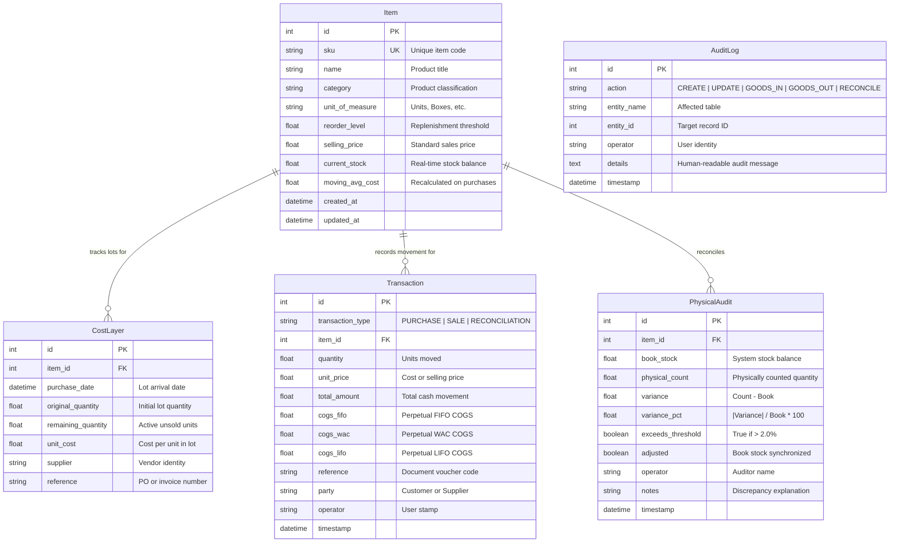

# AIS Inventory Management & Valuation System - Architecture & Technical Specification

**Course:** Accounting Information Systems (AIS) &bull; College Mini-Project  
**Domain:** Inventory Management, Dynamic Valuation &amp; Internal Controls  
**System Methodology:** Web Single-User Application &bull; REST API &bull; Neon PostgreSQL &bull; Docker Containerization

---

## 1. System Philosophy & The AIS Cycle

This mini-project operationalizes the core cycle of an **Accounting Information System (AIS)**:
$$\text{Input} \longrightarrow \text{Processing} \longrightarrow \text{Output} \longrightarrow \text{Control}$$

| Phase | System Implementation |
| :--- | :--- |
| **Input** | Standardized input validation for SKU creation, Goods In acquisitions, and Goods Out sales. Strictly blocks non-positive values. |
| **Processing** | Dynamic cost-layer maintenance, moving average recalculation (WAC), perpetual COGS derivation, and automated inventory depletion. |
| **Output** | Real-time Executive Dashboard KPIs, Chart.js visual distributions, interactive FIFO/WAC/LIFO reports, and financial ratio tracking. |
| **Control** | Nine hardcoded internal controls including No Negative Inventory, 2% reconciliation tolerance limit, and an immutable audit trail. |

---

## 2. Database Entities & Relational Schema

Designed for simplicity and strict accounting integrity:

---

## 3. Accounting Cost-Flow Algorithms

### 3.1 First-In, First-Out (FIFO)
- **Algorithm:** The system issues the oldest unexhausted cost layer first.
- **Valuation:** Ending inventory consists of the most recently acquired units, reflecting current market replenishment costs.

### 3.2 Weighted Average Cost (WAC)
- **Algorithm:** Dynamic moving average recalculated upon every Goods In purchase event:
$$\text{New Average Cost} = \frac{(\text{Current Stock} \times \text{Current WAC}) + (\text{New Quantity} \times \text{New Unit Cost})}{\text{Current Stock} + \text{New Quantity}}$$
- **Valuation:** Blends price volatility and stabilizes reported COGS across reporting periods.

### 3.3 Last-In, First-Out (LIFO)
- **Algorithm:** Simulated issuance of newest cost layers first.
- **Academic Context:** Explicitly tagged with an IAS 2.1.9 compliance warning noting that International Financial Reporting Standards prohibit LIFO due to distortion of ending inventory values on balance sheets.

### 3.4 Perpetual vs Periodic Inventory Systems
- **Perpetual:** Real-time stock decrement and transaction-level COGS computation upon every sales checkout.
- **Periodic:** Mathematically derived at closing:
$$\text{Goods Available for Sale} = \text{Beginning Inventory} + \text{Purchases}$$
$$\text{COGS} = \text{Goods Available for Sale} - \text{Ending Inventory Valuation}$$

---

## 4. Internal Controls Matrix Compliance

| Internal Control Rule | Enforcement Mechanism |
| :--- | :--- |
| **1. Input Validation** | Pydantic schemas reject non-numeric, zero, or negative quantities/prices. |
| **2. No Negative Inventory** | Goods Out transaction blocked if requested sales quantity exceeds physical stock on hand. |
| **3. Data Integrity** | Restricts deletion of any SKU that possesses an associated transaction history. |
| **4. Unique Item Codes** | Unique index on `items.sku` prevents duplicate SKU creation. |
| **5. Audit Trail** | System-wide immutable `audit_logs` permanently record operator identity and timestamps. |
| **6. Shrinkage Variance Engine** | Flags any physical stock discrepancy exceeding a **2.0% tolerance threshold**. |
| **7. ABC Classification** | Automated Pareto classification assigns tight controls to Class A items (75% value). |
| **8. Reorder Automation** | Automated visual alerts when stock on hand falls at or below designated threshold. |
| **9. Single-User Transparency** | Explicit operator stamping on every transactional voucher. |
