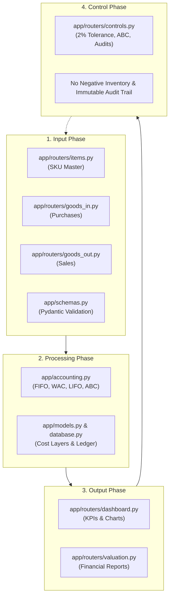

# Core Project Documentation Index

## Overview
This directory contains comprehensive, professional technical summaries for each core file in the **AIS Inventory Management & Valuation System** (excluding UI assets and Docker configuration).

Each document details the module's architectural purpose, position in the AIS cycle ($\text{Input} \to \text{Processing} \to \text{Output} \to \text{Control}$), key functions, database interactions, accounting rules, and internal control mechanisms.

---

## Core File Documentation Matrix

| Core Source File | Documentation Guide | AIS Cycle Stage | Primary Architectural Responsibility |
| :--- | :--- | :--- | :--- |
| [`app/config.py`](file:///E:/Enexabit/AIS_Inventory_system/app/config.py) | [config.md](file:///E:/Enexabit/AIS_Inventory_system/docs/config.md) | Foundation & Control | Application configuration, Neon PostgreSQL URL normalization, and operator identity setup. |
| [`app/database.py`](file:///E:/Enexabit/AIS_Inventory_system/app/database.py) | [database.md](file:///E:/Enexabit/AIS_Inventory_system/docs/database.md) | Foundation & Integrity | Dual engine connection management (Neon PostgreSQL pooling & SQLite fallback), sessions, and schema bootstrap. |
| [`app/models.py`](file:///E:/Enexabit/AIS_Inventory_system/app/models.py) | [models.md](file:///E:/Enexabit/AIS_Inventory_system/docs/models.md) | Input & Storage Structure | Persistent SQLAlchemy ORM relational models (`Item`, `CostLayer`, `Transaction`, `PhysicalAudit`, `AuditLog`). |
| [`app/schemas.py`](file:///E:/Enexabit/AIS_Inventory_system/app/schemas.py) | [schemas.md](file:///E:/Enexabit/AIS_Inventory_system/docs/schemas.md) | Input Validation | Pydantic schemas enforcing positive numbers, field bounds, and response payloads. |
| [`app/accounting.py`](file:///E:/Enexabit/AIS_Inventory_system/app/accounting.py) | [accounting.md](file:///E:/Enexabit/AIS_Inventory_system/docs/accounting.md) | Processing Engine | Mathematical engine for FIFO, WAC, LIFO, Pareto ABC analysis, and 2% variance checks. |
| [`app/main.py`](file:///E:/Enexabit/AIS_Inventory_system/app/main.py) | [main.md](file:///E:/Enexabit/AIS_Inventory_system/docs/main.md) | Integration & Lifecycles | FastAPI ASGI application root, lifespan startup context, CORS middleware, and health check. |
| [`app/routers/dashboard.py`](file:///E:/Enexabit/AIS_Inventory_system/app/routers/dashboard.py) | [router_dashboard.md](file:///E:/Enexabit/AIS_Inventory_system/docs/router_dashboard.md) | Output & Managerial KPIs | Executive dashboard summary endpoints, financial ratios, turnover, and Chart.js datasets. |
| [`app/routers/items.py`](file:///E:/Enexabit/AIS_Inventory_system/app/routers/items.py) | [router_items.md](file:///E:/Enexabit/AIS_Inventory_system/docs/router_items.md) | Input & Master Maintenance | Item catalog lifecycle (CRUD), unique SKU checks, and deletion restriction with transaction history. |
| [`app/routers/goods_in.py`](file:///E:/Enexabit/AIS_Inventory_system/app/routers/goods_in.py) | [router_goods_in.md](file:///E:/Enexabit/AIS_Inventory_system/docs/router_goods_in.md) | Input & Cost Layering | Stock purchases, dynamic moving average recalculation, cost layer creation, and audit logging. |
| [`app/routers/goods_out.py`](file:///E:/Enexabit/AIS_Inventory_system/app/routers/goods_out.py) | [router_goods_out.md](file:///E:/Enexabit/AIS_Inventory_system/docs/router_goods_out.md) | Input, Processing & Control | Stock sales, negative inventory blocking, perpetual COGS calculation, and layer depletion. |
| [`app/routers/valuation.py`](file:///E:/Enexabit/AIS_Inventory_system/app/routers/valuation.py) | [router_valuation.md](file:///E:/Enexabit/AIS_Inventory_system/docs/router_valuation.md) | Output & Financial Reports | Multi-method valuation reporting (FIFO/WAC/LIFO), perpetual vs periodic toggles, and IAS 2 compliance. |
| [`app/routers/controls.py`](file:///E:/Enexabit/AIS_Inventory_system/app/routers/controls.py) | [router_controls.md](file:///E:/Enexabit/AIS_Inventory_system/docs/router_controls.md) | Internal Control & Auditing | Automated reorder alerts, ABC classification, physical count reconciliation with 2% tolerance, and audit logs. |
| [`seed_data.py`](file:///E:/Enexabit/AIS_Inventory_system/seed_data.py) | [seed_data.md](file:///E:/Enexabit/AIS_Inventory_system/docs/seed_data.md) | Demonstration Baseline | Script seeding realistic retail items, multi-lot purchases, sales, and a 2% threshold reconciliation. |

---

## Architectural Workflow

