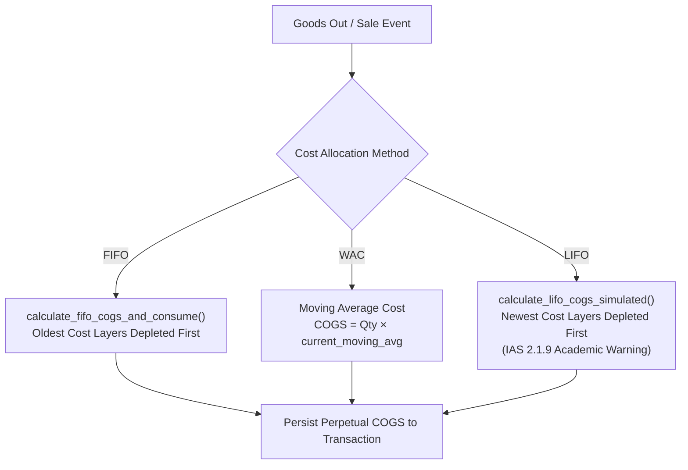

# Module Documentation: `app/accounting.py`

## 1. Executive Summary & Purpose
The [accounting.py](file:///E:/Enexabit/AIS_Inventory_system/app/accounting.py) module constitutes the mathematical and algorithmic core of the Accounting Information System. It executes all inventory valuation calculations, cost-flow allocations, dynamic moving average updates, Pareto ABC classifications, and audit discrepancy assessments.

---

## 2. AIS Cycle Phase: **Processing & Algorithmic Transformation**
This module operationalizes the **Processing** phase of the AIS cycle:
$$\text{Input (Purchases/Sales)} \longrightarrow \mathbf{\text{Processing (Cost Allocation Models)}} \longrightarrow \text{Output (Financial Reports)}$$

---

## 3. Core Algorithms & Methodologies

### 1. FIFO (First-In, First-Out) Algorithm
- **Function:** `calculate_fifo_cogs_and_consume(db, item_id, quantity_to_sell, commit_consumption=False) -> float`
- **Logic:** Queries active `CostLayer` rows sorted by `purchase_date ASC, id ASC`. Depletes each layer's `remaining_quantity` sequentially until the required sales volume is met.
- **Consumption Control:** When `commit_consumption=True` (during actual sales), the layer's `remaining_quantity` is decremented in the database session. If `commit_consumption=False`, it computes potential COGS without altering database state.

### 2. LIFO (Last-In, First-Out) Simulated Algorithm
- **Function:** `calculate_lifo_cogs_simulated(db, item_id, quantity_to_sell) -> float`
- **Logic:** Queries active `CostLayer` rows sorted by `purchase_date DESC, id DESC`. Computes COGS by consuming newest acquisition lots first.
- **Accounting Note:** IAS 2 (*Inventories*, paragraph 1.9) strictly prohibits LIFO due to unrepresentative balance sheet valuations in inflationary environments. This function is retained for comparative analysis and academic demonstration.

### 3. Dynamic Weighted Average Cost (WAC)
- **Function:** `update_moving_average_cost_on_purchase(current_stock, current_moving_avg, purchased_qty, purchased_unit_cost) -> float`
- **Formula:**
  $$\bar{C}_{\text{new}} = \frac{(Q_{\text{current}} \times \bar{C}_{\text{current}}) + (Q_{\text{new}} \times C_{\text{new}})}{Q_{\text{current}} + Q_{\text{new}}}$$
- **Execution:** Invoked during every Goods In acquisition prior to incrementing stock balance, maintaining perpetual moving average unit cost.

### 4. Ending Inventory Valuation by Method
- **Function:** `compute_item_valuation_by_method(db, item, method="FIFO") -> Dict[str, float]`
- **Outputs:** `{"stock": float, "valuation": float, "avg_unit_cost": float}`
- **Valuation Logic:**
  - **WAC:** Multiplies active stock by `item.moving_avg_cost`.
  - **FIFO:** Sums remaining layers in reverse order (newest layers represent ending inventory).
  - **LIFO:** Sums remaining layers in chronological order (oldest layers represent ending inventory).

### 5. ABC Inventory Classification (Pareto 80/15/5 Principle)
- **Function:** `generate_abc_analysis(items, db) -> List[Dict[str, Any]]`
- **Formula:** $\text{Annual/Total Usage Value} = \sum Q_{\text{sold}} \times \bar{C}_{\text{item}}$
- **Classification Thresholds:**
  - **Category A (Top 0% - 75% Cumulative Value):** High financial significance $\rightarrow$ Tight control, weekly cycle counting.
  - **Category B (75% - 90% Cumulative Value):** Moderate significance $\rightarrow$ Bi-weekly review, standard safety buffers.
  - **Category C (90% - 100% Cumulative Value):** Bulk/Low value $\rightarrow$ Periodic visual reviews, bulk ordering.

### 6. Physical Reconciliation & Shrinkage Variance
- **Function:** `calculate_reconciliation_variance(book_stock, physical_count) -> Tuple[float, float, bool]`
- **Calculation:**
  $$\text{Variance} = \text{Count} - \text{Book}$$
  $$\text{Variance \%} = \frac{|\text{Variance}|}{\text{Book}} \times 100$$
- **Internal Control Rule:** If $\text{Variance \%} > 2.0\%$, `exceeds_threshold` evaluates to `True`, triggering mandatory audit flags.

---

## 4. Key Accounting & Internal Controls Enforced
- **Real-Time Layer Depletion:** FIFO permanently tracks exact historical lots rather than applying backward estimations.
- **Rounding Accuracy:** Standardizes all monetary calculations to 2 decimal places (`round(val, 2)`).
- **Zero/Negative Stock Safeguards:** Defensive boundary conditions prevent division by zero when calculating unit averages for depleted stock.

---

## 5. Module Dependencies & Interconnections
- **Upstream:** Imports `Item`, `CostLayer`, and `Transaction` from [models.py](file:///E:/Enexabit/AIS_Inventory_system/app/models.py).
- **Downstream Consumers:**
  - [routers/goods_in.py](file:///E:/Enexabit/AIS_Inventory_system/app/routers/goods_in.py): Recalculates moving average on receipt.
  - [routers/goods_out.py](file:///E:/Enexabit/AIS_Inventory_system/app/routers/goods_out.py): Computes and commits perpetual FIFO/WAC/LIFO COGS.
  - [routers/valuation.py](file:///E:/Enexabit/AIS_Inventory_system/app/routers/valuation.py): Generates multi-method reports and comparisons.
  - [routers/controls.py](file:///E:/Enexabit/AIS_Inventory_system/app/routers/controls.py): Runs ABC classification and reconciliation evaluations.
  - [routers/dashboard.py](file:///E:/Enexabit/AIS_Inventory_system/app/routers/dashboard.py): Computes aggregate inventory valuations.
