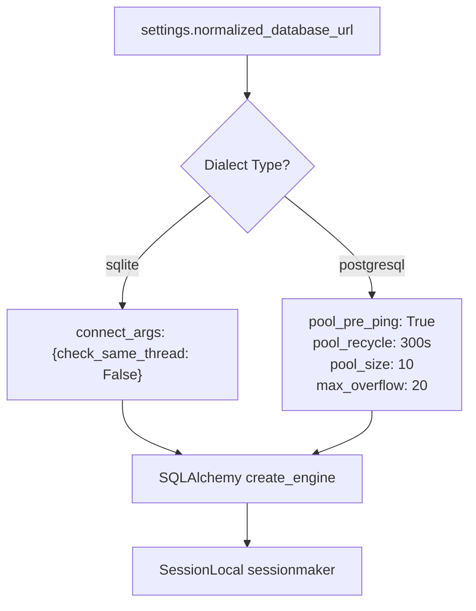

# Module Documentation: `app/database.py`

## 1. Executive Summary & Purpose
The [database.py](file:///E:/Enexabit/AIS_Inventory_system/app/database.py) module provides the database abstraction, connection lifecycle management, and SQLAlchemy session factory for the entire AIS platform. It manages dual database engines—optimizing for Neon Serverless PostgreSQL in production and local SQLite for offline demonstration.

---

## 2. AIS Cycle Phase: **Foundation & Integrity**
The database session layer guarantees the ACID (Atomicity, Consistency, Isolation, Durability) properties necessary for an Accounting Information System:
- **Transaction Isolation:** Requests execute within dedicated session scopes to prevent dirty reads or race conditions during inventory decrements and cost layer consumption.
- **Connection Health:** Automatic pinging and recycling handle serverless connection drops gracefully.

---

## 3. Core Components & Architecture

### Database Engine Configuration
The module automatically detects the target database dialect via `settings.normalized_database_url` and applies distinct operational configurations:

### Key Functions & Objects

| Component | Type | Description |
| :--- | :--- | :--- |
| `engine` | `Engine` | Global SQLAlchemy Engine binding connection pools to the configured database URL. |
| `SessionLocal` | `sessionmaker` | Configured session factory (`autocommit=False, autoflush=False`) ensuring explicit transaction boundaries. |
| `Base` | `DeclarativeMeta` | Base class for all ORM data models registered under SQLAlchemy's metadata registry. |
| `get_db()` | `Generator[Session, None, None]` | FastAPI dependency injection generator yielding a thread-safe database session per HTTP request and guaranteeing `session.close()` in `finally:`. |
| `init_db()` | `Callable[[], None]` | Bootstraps schema generation by invoking `Base.metadata.create_all(bind=engine)` upon application startup. |

---

## 4. Key Accounting & Internal Controls Enforced
- **Atomic Rollbacks:** Because `autocommit=False`, any runtime validation failure (e.g., negative stock, unauthorized tolerance exceedance) automatically permits discarding uncommitted ledger changes.
- **Connection Resiliency for Serverless Neon:** Neon PostgreSQL automatically sleeps idle compute nodes; `pool_pre_ping=True` detects dormant connections before executing queries, preventing stale connection errors.
- **Thread Safety for FastAPI Concurrency:** In SQLite fallback mode, `check_same_thread=False` allows multiple asynchronous endpoint handlers to share sessions safely without throwing SQLite thread errors.

---

## 5. Module Dependencies & Interconnections
- **Upstream:** Imports settings from [config.py](file:///E:/Enexabit/AIS_Inventory_system/app/config.py).
- **Model Registration:** Referenced by [models.py](file:///E:/Enexabit/AIS_Inventory_system/app/models.py) to extend `Base`.
- **Application Lifecycle:** Imported by [main.py](file:///E:/Enexabit/AIS_Inventory_system/app/main.py) (`init_db()` called in `lifespan` handler) and all API routers to inject `Depends(get_db)`.
