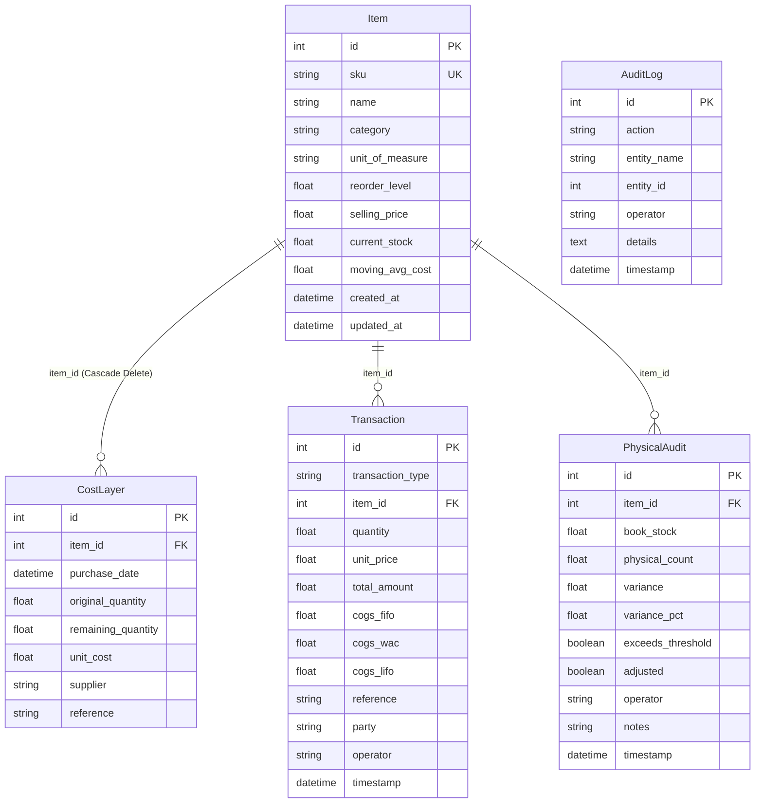

# Module Documentation: `app/models.py`

## 1. Executive Summary & Purpose
The [models.py](file:///E:/Enexabit/AIS_Inventory_system/app/models.py) module defines the persistent relational database schema using SQLAlchemy ORM. It establishes the foundational entities required to support multi-method inventory valuation (FIFO, WAC, LIFO), perpetual inventory tracking, physical stock reconciliations, and an immutable audit trail.

---

## 2. AIS Cycle Phase: **Input & Data Storage Structure**
In the AIS cycle, data models represent the single source of truth for all inventory movements, accounting values, and internal control validations.

---

## 3. Entity Specifications

### 1. `Item` (`items` table)
Represents the Master Inventory Catalog (SKUs).
- **`id`** (`Integer`, PK): Unique surrogate key.
- **`sku`** (`String(50)`, UK, Indexed): Case-insensitive unique stock-keeping code.
- **`name`** (`String(120)`): Product title.
- **`category`** (`String(60)`): Category classification (Electronics, Displays, Audio, etc.).
- **`unit_of_measure`** (`String(20)`): Measurement unit (e.g., Unit, Box, Meter).
- **`reorder_level`** (`Float`): Inventory replenishment trigger threshold.
- **`selling_price`** (`Float`): Standard retail selling price per unit.
- **`current_stock`** (`Float`): Real-time balance of physical units on hand.
- **`moving_avg_cost`** (`Float`): Dynamic weighted average unit cost recalculated upon each purchase.
- **Timestamps:** `created_at`, `updated_at` (automatic UTC tracking).

### 2. `CostLayer` (`cost_layers` table)
Maintains distinct historical purchase lots for granular FIFO and LIFO cost-flow consumption.
- **`item_id`** (`Integer`, FK -> `items.id`): Associated master SKU.
- **`purchase_date`** (`DateTime`): Acquisition timestamp.
- **`original_quantity`** (`Float`): Quantity originally received in the purchase batch.
- **`remaining_quantity`** (`Float`): Active unconsumed quantity available in this lot.
- **`unit_cost`** (`Float`): Specific acquisition cost per unit for this lot.
- **`supplier`**, **`reference`**: Vendor name and document/PO voucher identifier.

### 3. `Transaction` (`transactions` table)
Permanent journal tracking every inventory movement:
- **`transaction_type`** (`String(30)`): `PURCHASE`, `SALE`, or `RECONCILIATION_ADJUSTMENT`.
- **`quantity`**, **`unit_price`**, **`total_amount`**: Commercial values.
- **Pre-computed Perpetual COGS:** `cogs_fifo`, `cogs_wac`, `cogs_lifo` stored at the time of sale for instant multi-framework financial reporting.
- **Provenance Stamping:** `reference`, `party` (Customer or Vendor), `operator` (User identity), and `timestamp`.

### 4. `PhysicalAudit` (`physical_audits` table)
Documents periodic physical count counts vs book stock balances:
- **`book_stock`**, **`physical_count`**: System balance vs verified on-site count.
- **`variance`**, **`variance_pct`**: Derived shrinkage or overage ($Count - Book$ and percentage).
- **`exceeds_threshold`** (`Boolean`): Automated flag set to `True` if $|Variance| / Book \times 100 > 2.0\%$.
- **`adjusted`** (`Boolean`): Indicates if book balance was officially reconciled to physical count.

### 5. `AuditLog` (`audit_logs` table)
Append-only tamper-evident audit ledger capturing user actions (`CREATE_ITEM`, `UPDATE_ITEM`, `GOODS_IN`, `GOODS_OUT`, `RECONCILE`, `DELETE_ITEM`) with UTC timestamps, target entity details, and responsible operator stamp.

---

## 4. Key Accounting & Internal Controls Enforced
- **Cascade Protection on Item Master:** Foreign keys link transactions, cost layers, and physical audits back to the item master. API logic prohibits dropping items with active transaction records.
- **Granular Lot Tracing:** By preserving `CostLayer` records independently of the `Item.current_stock` aggregate, the system guarantees mathematical reproducibility of FIFO and LIFO allocations.
- **Dual Verification Attributes:** The `PhysicalAudit` entity separates the detection of variance from the authorization to adjust inventory balances.

---

## 5. Module Dependencies & Interconnections
- **Upstream:** Inherits `Base` from [database.py](file:///E:/Enexabit/AIS_Inventory_system/app/database.py).
- **Downstream Consumers:**
  - [schemas.py](file:///E:/Enexabit/AIS_Inventory_system/app/schemas.py): Pydantic response models mirror these database entities.
  - [accounting.py](file:///E:/Enexabit/AIS_Inventory_system/app/accounting.py): Queries `CostLayer`, `Item`, and `Transaction` to execute cost allocation algorithms.
  - All routers in `app/routers/` execute CRUD queries against these models.
