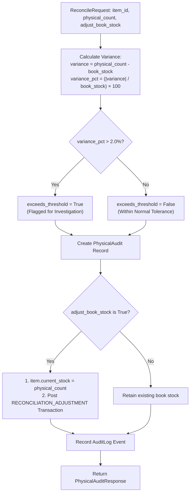

# Module Documentation: `app/routers/controls.py`

## 1. Executive Summary & Purpose
The [controls.py](file:///E:/Enexabit/AIS_Inventory_system/app/routers/controls.py) router operationalizes the managerial oversight and internal controls framework of the Accounting Information System. It exposes endpoints for automated replenishment alerts, Pareto ABC inventory classification, physical stock reconciliation with tolerance threshold enforcement, and immutable audit trail retrieval.

---

## 2. AIS Cycle Phase: **Internal Control & Managerial Oversight**
This module forms the **Control** pillar of the AIS cycle ($\text{Input} \to \text{Processing} \to \text{Output} \to \mathbf{\text{Control}}$):
- Enforces segregation between variance detection and ledger adjustment.
- Enforces an automated $2.0\%$ shrinkage/overage investigation rule.
- Preserves an unalterable chronological audit log.

---

## 3. Endpoints & Operations

### 1. `GET /api/controls/reorder-alerts`
- **Output:** List of `ItemResponse` objects whose `current_stock <= reorder_level`, ordered ascending by stock balance.
- **Internal Control:** Proactive stockout prevention mechanism signaling purchasing requisitions before disruption occurs.

### 2. `GET /api/controls/abc-analysis`
- **Output:** List of `ABCClassificationItem` records derived via `generate_abc_analysis()`.
- **Managerial Decision Framework:**
  - **Category A (Top 0-75% cumulative value):** High financial exposure $\rightarrow$ Recommends tight control, weekly physical counts, and strict replenishment monitoring.
  - **Category B (Next 75-90% cumulative value):** Moderate exposure $\rightarrow$ Recommends bi-weekly reviews and standard safety buffers.
  - **Category C (Bottom 90-100% cumulative value):** Low exposure $\rightarrow$ Recommends basic control and periodic bulk ordering.

### 3. `POST /api/controls/reconcile` (Status 201 Created)
- **Input:** `ReconcileRequest` payload (`item_id`, `physical_count`, `adjust_book_stock: bool`, `notes`, `operator`).
- **Processing Logic & 2.0% Tolerance Rule:**

- **Output:** `PhysicalAuditResponse` with verified variance statistics and threshold alerts.

### 4. `GET /api/controls/reconciliations`
- **Parameters:** `limit: int = 50` (Query parameter).
- **Output:** Chronological list of historical physical reconciliation audits, recording book counts, physical counts, variance percentages, adjustment states, auditor stamps, and notes.

### 5. `GET /api/controls/audit-trail`
- **Parameters:** `limit: int = 100` (Query parameter).
- **Output:** Chronological, immutable audit trail records (`AuditLogResponse`) documenting all system state alterations with timestamps, entity IDs, and operator identities.

---

## 4. Key Accounting & Internal Controls Enforced
- **The 2% Reconciliation Tolerance Rule:** Reconciliations where the discrepancy percentage exceeds $2.0\%$ of book balance are systematically flagged with `exceeds_threshold=True`, satisfying internal control auditing standards.
- **Controlled Adjustments:** Physical counts do not modify book balances unless explicitly requested via `adjust_book_stock=True`. When adjusted, a compensating `RECONCILIATION_ADJUSTMENT` journal entry is posted to maintain ledger balance.
- **Immutable Audit Ledger:** System events cannot be updated or deleted via API endpoints, ensuring non-repudiation.

---

## 5. Module Dependencies & Interconnections
- **Upstream:**
  - [database.py](file:///E:/Enexabit/AIS_Inventory_system/app/database.py): Session provider `Depends(get_db)`.
  - [models.py](file:///E:/Enexabit/AIS_Inventory_system/app/models.py): Mutates `Item`, writes `PhysicalAudit`, `Transaction`, and `AuditLog`.
  - [schemas.py](file:///E:/Enexabit/AIS_Inventory_system/app/schemas.py): Validates `ReconcileRequest`, formats responses.
  - [accounting.py](file:///E:/Enexabit/AIS_Inventory_system/app/accounting.py): Calls `generate_abc_analysis()`, `calculate_reconciliation_variance()`, `compute_item_valuation_by_method()`.
  - [config.py](file:///E:/Enexabit/AIS_Inventory_system/app/config.py): Operator identity stamping.
- **Downstream:**
  - Mounted onto FastAPI in [main.py](file:///E:/Enexabit/AIS_Inventory_system/app/main.py).
