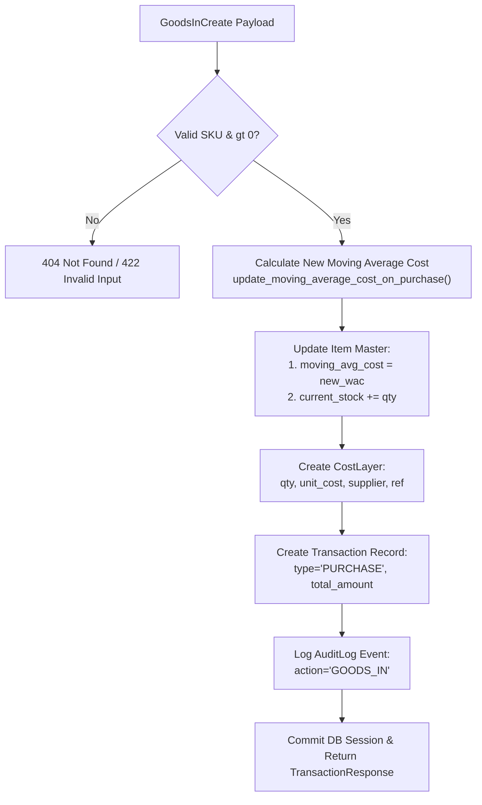

# Module Documentation: `app/routers/goods_in.py`

## 1. Executive Summary & Purpose
The [goods_in.py](file:///E:/Enexabit/AIS_Inventory_system/app/routers/goods_in.py) router manages inventory acquisition events (Purchases). It executes the complete accounting workflow for incoming stock: recalculating dynamic weighted average costs, establishing persistent acquisition lots (cost layers), augmenting physical on-hand balances, and stamping ledger journals.

---

## 2. AIS Cycle Phase: **Input & Cost Layer Processing**
In the AIS cycle, Goods In executes the entry point of the acquisition transaction cycle:

---

## 3. Endpoints & Operations

### 1. `POST /api/goods-in` (Status 201 Created)
- **Input:** `GoodsInCreate` payload containing `item_id`, `quantity`, `unit_cost`, `supplier`, `reference`, and optional `operator`.
- **Processing Steps:**
  1. **Item Validation:** Verifies existence of `item_id`. Raises `404 Not Found` if missing.
  2. **Moving Average Recalculation:** Invokes `update_moving_average_cost_on_purchase()` before modifying stock balance.
  3. **Stock Increment:** Adds acquired quantity directly to `Item.current_stock`.
  4. **Cost Layer Instantiation:** Inserts a new `CostLayer` with `original_quantity = quantity` and `remaining_quantity = quantity` at `unit_cost`.
  5. **Transaction Recording:** Inserts a permanent `PURCHASE` record into `Transaction` with `total_amount = round(quantity * unit_cost, 2)`.
  6. **Audit Stamping:** Appends a `GOODS_IN` entry to `AuditLog` including acquired volume, cost, vendor, and new moving average cost.
- **Output:** Serialized `TransactionResponse`.

### 2. `GET /api/goods-in`
- **Parameters:** `limit: int = 50` (Query parameter).
- **Output:** Reverse-chronological list of purchase transactions enriched with target SKU codes and product titles.

---

## 4. Key Accounting & Internal Controls Enforced
- **Strictly Positive Values:** Quantities and acquisition unit costs are enforced strictly greater than zero (`gt=0.0`) by Pydantic schemas.
- **Chronological Cost Layer Isolation:** Each purchase batch creates an independent `CostLayer` record, ensuring that future price inflation or deflation is captured accurately for FIFO/LIFO computations.
- **WAC Timeliness:** The weighted average unit cost is updated dynamically at the moment of receipt, preventing retroactive valuation distortion.

---

## 5. Module Dependencies & Interconnections
- **Upstream:**
  - [database.py](file:///E:/Enexabit/AIS_Inventory_system/app/database.py): Session provider `Depends(get_db)`.
  - [models.py](file:///E:/Enexabit/AIS_Inventory_system/app/models.py): Mutates `Item`, creates `CostLayer`, `Transaction`, and `AuditLog`.
  - [schemas.py](file:///E:/Enexabit/AIS_Inventory_system/app/schemas.py): Validates `GoodsInCreate` and shapes `TransactionResponse`.
  - [accounting.py](file:///E:/Enexabit/AIS_Inventory_system/app/accounting.py): Calls `update_moving_average_cost_on_purchase()`.
  - [config.py](file:///E:/Enexabit/AIS_Inventory_system/app/config.py): Operator fallback stamping.
- **Downstream:**
  - Mounted onto FastAPI in [main.py](file:///E:/Enexabit/AIS_Inventory_system/app/main.py).
  - Supplies cost layers consumed downstream by [routers/goods_out.py](file:///E:/Enexabit/AIS_Inventory_system/app/routers/goods_out.py).
