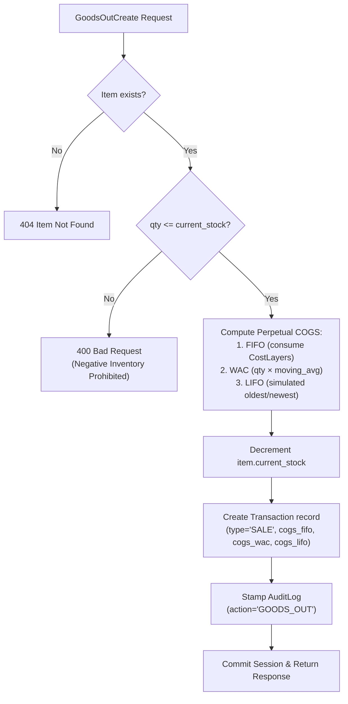

# Module Documentation: `app/routers/goods_out.py`

## 1. Executive Summary & Purpose
The [goods_out.py](file:///E:/Enexabit/AIS_Inventory_system/app/routers/goods_out.py) router records inventory sales and stock dispatches. It enforces the system's most critical internal accounting control (**No Negative Inventory**), calculates perpetual Cost of Goods Sold (COGS) across FIFO, WAC, and LIFO methods, depresses active cost layers, decrements inventory balances, and logs immutable transaction audit records.

---

## 2. AIS Cycle Phase: **Input, Processing & Internal Control**
Goods Out is the sales fulfillment stage of the revenue cycle, executing continuous control and real-time processing:

---

## 3. Endpoints & Operations

### 1. `POST /api/goods-out` (Status 201 Created)
- **Input:** `GoodsOutCreate` payload (`item_id`, `quantity`, `selling_price`, `customer`, `reference`, `operator`).
- **Core Enforcement & Processing Steps:**
  1. **SKU Existence Check:** Returns `404 Not Found` if item does not exist.
  2. **Negative Inventory Prevention (Critical Internal Control):** Compares `payload.quantity` against `item.current_stock`. If requested quantity exceeds on-hand balance, immediately aborts with `400 Bad Request` ("Negative Inventory Violation: Requested quantity exceeds current physical stock on hand").
  3. **Multi-Method Perpetual COGS Derivation:**
     - **FIFO:** Calls `calculate_fifo_cogs_and_consume(..., commit_consumption=True)`. Exhausts the oldest available `CostLayer` rows in chronological order, decrementing their `remaining_quantity`.
     - **WAC:** Multiplies requested quantity by the item's live `moving_avg_cost`.
     - **LIFO:** Calls `calculate_lifo_cogs_simulated(...)` to determine the hypothetical LIFO cost.
  4. **Stock Decrement:** Decrements `item.current_stock -= payload.quantity`.
  5. **Transaction Journaling:** Saves a `SALE` entry in `Transaction` recording quantity, unit selling price, revenue (`total_amount`), and pre-calculated COGS values under all 3 methods.
  6. **Audit Stamping:** Appends a `GOODS_OUT` event to `AuditLog`.
- **Output:** Serialized `TransactionResponse`.

### 2. `GET /api/goods-out`
- **Parameters:** `limit: int = 50` (Query parameter).
- **Output:** Reverse-chronological list of recent sales transactions enriched with target SKU metadata, selling prices, and perpetual COGS amounts.

---

## 4. Key Accounting & Internal Controls Enforced
- **Strict Negative Inventory Prohibition:** Prevents stock balances from falling below zero, eliminating phantom inventory, phantom negative cost allocations, and un-reconciled short positions.
- **Perpetual Cost Layer Depletion:** Ensures cost layers are physically decremented in the database when FIFO sales execute, maintaining full auditing traceability for each remaining unit.
- **Simultaneous Multi-Method Storage:** By capturing `cogs_fifo`, `cogs_wac`, and `cogs_lifo` in the same transaction record, the system enables instantaneous comparative financial analysis without complex retroactive reprocessing.

---

## 5. Module Dependencies & Interconnections
- **Upstream:**
  - [database.py](file:///E:/Enexabit/AIS_Inventory_system/app/database.py): Session provider `Depends(get_db)`.
  - [models.py](file:///E:/Enexabit/AIS_Inventory_system/app/models.py): Mutates `Item`, `CostLayer`, and persists `Transaction` and `AuditLog`.
  - [schemas.py](file:///E:/Enexabit/AIS_Inventory_system/app/schemas.py): Validates `GoodsOutCreate` and formats `TransactionResponse`.
  - [accounting.py](file:///E:/Enexabit/AIS_Inventory_system/app/accounting.py): Invokes `calculate_fifo_cogs_and_consume()` and `calculate_lifo_cogs_simulated()`.
  - [config.py](file:///E:/Enexabit/AIS_Inventory_system/app/config.py): Operator fallback stamping.
- **Downstream:**
  - Mounted onto FastAPI in [main.py](file:///E:/Enexabit/AIS_Inventory_system/app/main.py).
  - Supplies transaction history aggregated by [routers/dashboard.py](file:///E:/Enexabit/AIS_Inventory_system/app/routers/dashboard.py) and [routers/valuation.py](file:///E:/Enexabit/AIS_Inventory_system/app/routers/valuation.py).
