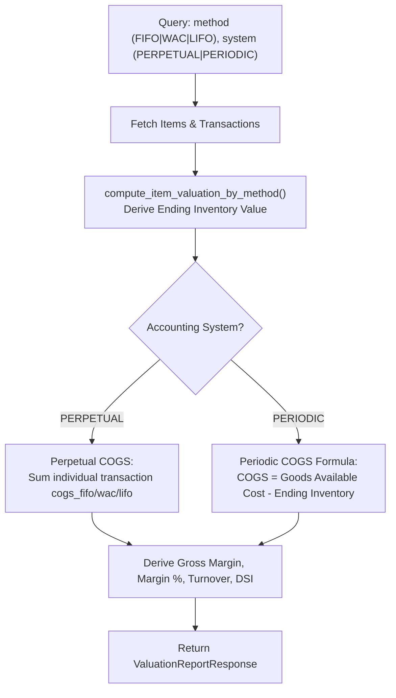

# Module Documentation: `app/routers/valuation.py`

## 1. Executive Summary & Purpose
The [valuation.py](file:///E:/Enexabit/AIS_Inventory_system/app/routers/valuation.py) router serves as the primary financial reporting engine of the AIS platform. It generates dynamic, multi-dimensional inventory valuation statements, allowing managers and auditors to compare cost-flow assumptions (FIFO, WAC, LIFO) and inventory tracking methodologies (Perpetual vs Periodic).

---

## 2. AIS Cycle Phase: **Processing & Financial Output**
In the AIS cycle, Valuation Report Engine translates transaction histories into formal accounting statements:
- Computes Cost of Goods Available for Sale (Beginning Inventory + Net Purchases).
- Derives Cost of Goods Sold (COGS) and Ending Inventory Valuation under user-selected accounting rules.
- Calculates managerial margins and efficiency metrics (Gross Margin %, Inventory Turnover, and Days Sales in Inventory).

---

## 3. Endpoints & Operations

### 1. `GET /api/valuation/report`
Generates comprehensive valuation statement supporting dynamic accounting toggles:
- **Query Parameters:**
  - `method`: `FIFO` (default), `WAC`, or `LIFO`. Enforced via regex pattern `^(FIFO|WAC|LIFO)$`.
  - `system`: `PERPETUAL` (default) or `PERIODIC`. Enforced via regex pattern `^(PERPETUAL|PERIODIC)$`.

#### Processing Logic & Derivations

#### Key Output Fields (`ValuationReportResponse`)
- **Metadata:** `method`, `system`, `generated_at`, and `compliance_note`.
- **System Totals:** `total_goods_available_cost`, `total_cogs`, `total_ending_inventory_value`, `total_revenue`, `total_gross_margin`, `overall_gross_margin_pct`, `overall_turnover_rate`, `overall_days_in_inventory`.
- **`items` (List of `ValuationItemDetail`):** Granular per-SKU breakdown including current stock, moving average cost, goods available for sale, COGS, ending valuation, revenue, and turnover ratios.

### 2. `GET /api/valuation/comparison`
Returns a side-by-side comparative financial impact analysis of all three valuation methods (FIFO, WAC, and LIFO) under perpetual tracking.

| Metric Calculated | FIFO | WAC | LIFO (Simulated) |
| :--- | :--- | :--- | :--- |
| **Ending Inventory Value** | Highest in inflationary trends | Weighted middle | Lowest in inflationary trends |
| **Cost of Goods Sold (COGS)** | Lowest in inflationary trends | Weighted middle | Highest in inflationary trends |
| **Gross Margin ($ and %)** | Maximized profit | Smoothed profit | Minimized profit |
| **Inventory Turnover Rate** | Lower ratio | Moderate ratio | Higher ratio |

---

## 4. Key Accounting & Compliance Controls
- **IAS 2.1.9 Regulatory Compliance Notice:** If `method == "LIFO"`, the report automatically attaches an advisory disclosure:
  > *"Academic Demonstration Only: International Accounting Standard IAS 2.1.9 prohibits the use of LIFO (Last-In, First-Out) for general-purpose financial reporting due to potential mismatch with physical inventory flow and profit distortion."*
- **Mathematical Balance Sheet Reconciliation:** Under the periodic system, the fundamental inventory accounting identity is strictly preserved:
  $$\text{Beginning Inventory} + \text{Purchases} = \text{Cost of Goods Sold} + \text{Ending Inventory}$$
- **Turnover & DSI Formulas:**
  $$\text{Inventory Turnover} = \frac{\text{COGS}}{\text{Ending Inventory Valuation}}$$
  $$\text{Days Sales in Inventory (DSI)} = \frac{365}{\text{Inventory Turnover}}$$

---

## 5. Module Dependencies & Interconnections
- **Upstream:**
  - [database.py](file:///E:/Enexabit/AIS_Inventory_system/app/database.py): Session provider `Depends(get_db)`.
  - [models.py](file:///E:/Enexabit/AIS_Inventory_system/app/models.py): Queries `Item` and `Transaction` records.
  - [schemas.py](file:///E:/Enexabit/AIS_Inventory_system/app/schemas.py): Structures `ValuationReportResponse` and `ValuationItemDetail`.
  - [accounting.py](file:///E:/Enexabit/AIS_Inventory_system/app/accounting.py): Invokes `compute_item_valuation_by_method()`.
- **Downstream:**
  - Mounted onto FastAPI in [main.py](file:///E:/Enexabit/AIS_Inventory_system/app/main.py).
  - Supplies financial statements rendered in the web UI.
